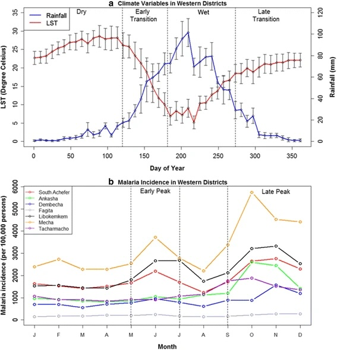

Climate is an important driver of infectious disease transmission, influencing the geographic distributions of pathogens and their hosts, the seasonal timing of transmission, and the occurrence of disease outbreaks. Understanding this variability is essential for anticipating how infectious diseases respond to short-term weather events, seasonal climate fluctuations, and long-term climate change. Our research has advanced understanding of the climatic drivers of West Nile virus (WNV) in the United States and malaria in Ethiopia and India. Studies of WNV outbreaks in the northern Great Plains demonstrated that disease incidence was highest in areas with warmer temperatures and intermediate precipitation ([Wimberly et al. 2008](#weather-refs)), while subsequent research identified elevated temperatures during both winter and the transmission season as important predictors of outbreaks ([Wimberly et al. 2014](#weather-refs)). Time-series modeling in South Dakota and Louisiana further demonstrated the importance of temperature, precipitation, atmospheric humidity, and wind speed in explaining seasonal and interannual variation in WNV transmission ([Davis et al. 2018](#weather-refs), [Bump et al. 2025](#weather-refs)).

  *Data from the Ahmara Region of Ethiopia illustrating seasonal patterns of temperature and precipitation and their associations with malaria cases (Midekisa et al. 2015).*

An important contribution of this work has been demonstrating that the climatic drivers of disease transmission vary across geographic and environmental settings. For example, our research in Ethiopia showed that temperature was a stronger predictor of malaria outbreaks in wetter districts, whereas rainfall and moisture conditions were more influential in drier districts ([Midekisa et al. 2015](#weather-refs)). In the United States, temperature and humidity had positive effects on WNV occurence in a cooler and drier climate versus negative effects in a warmer and more humid climate [Bump et al. 2025](#weather-refs)). These findings highlight the importance of accounting for local environmental conditions rather than assuming that climate–disease relationships are uniform across regions. This research has established a foundation for climate-informed disease forecasting and early warning systems. By integrating environmental observations with disease surveillance data, we have developed predictive models that account for delayed responses to weather conditions and spatial variation in climatic drivers ([Midekisa et al. 2012](#weather-refs); [Davis et al. 2019](#weather-refs)). These approaches provide a scientific basis for anticipating disease outbreaks and supporting more proactive public health surveillance and response. For more information see the sections on [Malaria Early Warning](malaria_forecasting.qmd) and [West Nile Virus Forecasting](wnv_forecasting.qmd).

### References {#weather-refs}

- Bump, E. R., Bharadwaja, A., Simonson, S., Ortega, E., & Wimberly, M. C. (2025). [Integrating wind speed into climate‐based West Nile virus models: A comparative analysis in two distinct regions](https://doi.org/10.1029/2024GH001320). GeoHealth, 9, e2024GH001320.
- Davis, J. K., Gebrehiwot, T., Worku. M., Awoke, W., Mihretie, A., Nekorchuk, D., and M. C. Wimberly. 2019. [A genetic algorithm for identifying spatially-varying environmental drivers in a malaria time series model](https://www.sciencedirect.com/science/article/pii/S136481521930129X). Environmental Modelling and Software 119: 275-284.
- Davis, J. K., G. P. Vincent, M. B. Hildreth, L. Kightlinger, C. Carlson, and M. C. Wimberly. 2018. [Improving the prediction of arbovirus outbreaks: a comparison of climate-driven models for West Nile virus in an endemic region of the United States](https://www.sciencedirect.com/science/article/pii/S0001706X18300512). Acta Tropica 185: 242-250.
- Midekisa A., B. Beyene, A. Mihretie, E. Bayabil, M. C. Wimberly. 2015. [Seasonal associations of climatic drivers and malaria in the highlands of Ethiopia](https://parasitesandvectors.biomedcentral.com/articles/10.1186/s13071-015-0954-7). Parasites & Vectors 8: 339.
- Wimberly, M. C., A. Lamsal, P. Giacomo, and T. Chuang. 2014. [Regional variation of climatic influences on West Nile virus outbreaks in the United States](http://www.ajtmh.org/content/journals/10.4269/ajtmh.14-0239). American Journal of Tropical Medicine and Hygiene 91: 677-684.
- Midekisa, A., G. Senay, G. M. Henebry, P. Semuniguse, and M. C. Wimberly. 2012. [Remote sensing-based time series models for malaria early warning in the highlands of Ethiopia](https://malariajournal.biomedcentral.com/articles/10.1186/1475-2875-11-165). Malaria Journal 11: 165.
- Wimberly, M. C., M. B. Hildreth, S. P. Boyte, E. Lindquist, and L. Kightlinger. 2008. [Ecological niche of the 2003 West Nile virus epidemic in the northern Great Plains of the United States](https://journals.plos.org/plosone/article?id=10.1371/journal.pone.0003744). PLoS One 3: e3744.

------------------------------------------------------------------------
