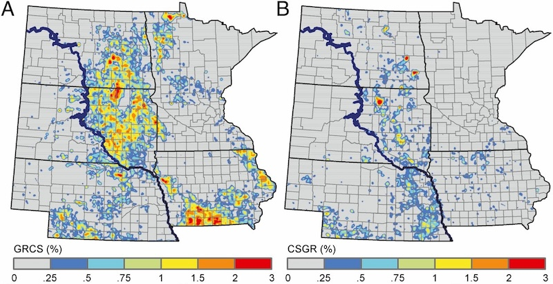

North America's grasslands are among its most threatened ecosystems, facing widespread conversion to agriculture and increasing encroachment by woody vegetation. These changes threaten biodiversity, fragment wildlife habitats, and diminish ecosystem services such as carbon storage, soil conservation, and water quality protection. Our research uses satellite Earth observations and geospatial analysis to quantify grassland loss, investigate its underlying drivers, and assess the ecological consequences of landscape transformation. We have focused particularly on the northern Great Plains, including the Prairie Pothole Region, where grasslands and wetlands provide critical habitat for migratory birds and other wildlife.

  *Maps of the western corn belt showing conversion of grasslands to corn and soy agriculture (left) and conversion of corn and soy agriculture to grasslands (right) (Wright and Wimberly 2011).*

Our studies have documented extensive grassland conversion associated with agricultural expansion in the western Corn Belt. Between 2007 and 2011, more than 500,000 hectares of grassland were converted to cropland, including substantial areas of previously undisturbed native prairie ([Wright and Wimberly, 2013](#grass-refs)). We identified agricultural and socioeconomic factors associated with conversion, including farm size, land tenure, farm income, and crop productivity ([Wimberly et al. 2017](#grass-refs)). We also demonstrated that remaining native grasslands in eastern South Dakota are highly fragmented, with connectivity among larger habitat areas dependent on networks of smaller, scattered patches ([Wimberly et al. 2018](#grass-refs)). These findings highlight the importance of protecting remaining native prairie and maintaining landscape connectivity in regions undergoing agricultural intensification.

  *Maps of the extent of Juniperus virginiana across eastern South Dakota derived from snow-covered Landsat imagery (Kaskie et al. 2019).*

Woody plant encroachment represents a second major threat to Great Plains grasslands. The spread of eastern redcedar (*Juniperus virginiana*) alters grassland structure and habitat conditions, but early stages of invasion can be difficult to detect using conventional land cover maps. We developed satellite-based methods to quantify redcedar cover ([Kaskie et al. 2019](#grass-refs)) and identify low-density stands where encroachment is beginning ([Kaskie et al. 2022](#grass-refs)). These approaches provide tools for monitoring the spread of woody vegetation and identifying areas where early intervention may help prevent further grassland degradation.

### References {#grass-refs}

- Kaskie, K. D., M. C. Wimberly, and P. J. Bauman. 2022. [Predictive mapping of low-density juniper stands in prairie landscapes of the northern Great Plains](https://www.sciencedirect.com/science/article/pii/S1550742422000367). Rangeland Ecology & Management 83: 81-90.
- Kaskie, K. D., M. C. Wimberly, and P. J. Bauman. 2019. [Rapid assessment of juniper distribution in prairie landscapes of the northern Great Plains](https://www.sciencedirect.com/science/article/pii/S0303243419306294). International Journal of Applied Earth Observation and Geoinformation 83: 101946.
- Wimberly, M. C., D. M. Narem, P. J. Bauman, B. T. Carlson, and M. A. Ahlering. 2018. [Grassland connectivity in fragmented agricultural landscapes of the north-central United States](https://www.sciencedirect.com/science/article/pii/S0006320717311308). Biological Conservation 217: 121-130.
- Wimberly, M. C., L. L. Janssen, D. A. Hennessy, M. Luri, N. M. Chowdhury, and H. Feng. 2017. [Cropland expansion and grassland loss in the eastern Dakotas: New insights from a farm-level survey](https://www.sciencedirect.com/science/article/pii/S0264837716310857). Land Use Policy 63: 160-173.
- Wright, C. K., and M. C. Wimberly. 2013. [Recent land use change in the western Corn Belt threatens grasslands and wetlands](http://www.pnas.org/content/110/10/4134). Proceedings of the National Academy of Sciences of the United States of America 110: 4134-4139.
