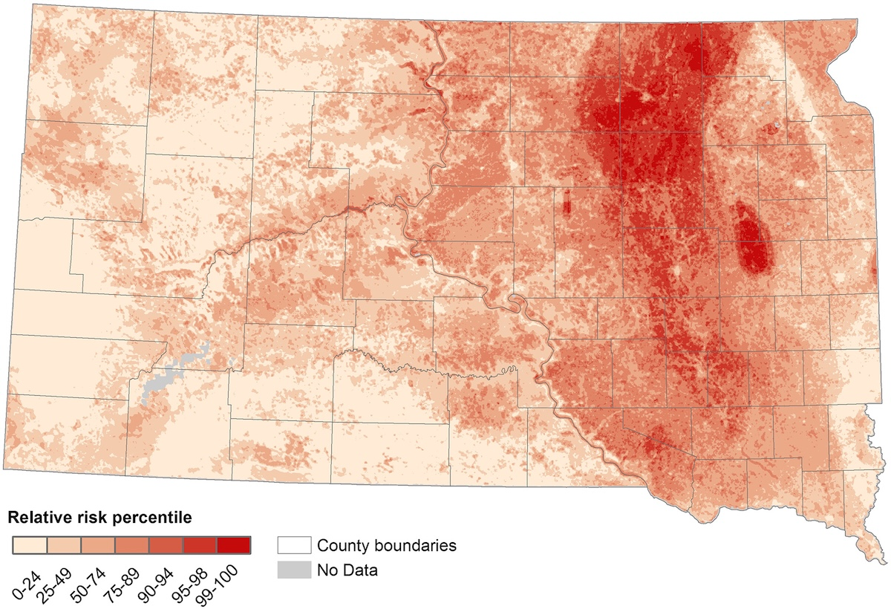

Land cover and land use influence infectious disease transmission by shaping the habitats of disease vectors and reservoir hosts and affecting human exposure to pathogens. Vegetation, hydrology, and built environments determine habitat suitability, while human activities such as urbanization, agriculture, and resource extraction modify natural habitats and create new opportunities for disease transmission. Land cover also influences local microclimates, potentially allowing vectors and hosts to persist in regions where broader climatic conditions would otherwise be unsuitable.

  *Map of the relative risk of West Nile virus in South Dakota derived from a machine learning model that predicts georeferenced cases using remotely sensed environmental indices (Hess et al. 2018).*

Our research has demonstrated how landscape characteristics influence the spatial distribution of mosquito-borne diseases across diverse geographic settings. In the northern Great Plains of the United States, we found that West Nile virus (WNV) incidence was highest in rural valleys dominated by grasslands and lowest in urban and forested mountainous regions ([Chuang et al., 2012](#land-refs); [Hess et al., 2018](#land-refs)). In the Amhara region of Ethiopia, malaria incidence was highest in districts with extensive wetland cover ([Midekisa et al. 2014](#land-refs)). However, a more localized analysis of malaria transmission in four Ethiopian districts revealed different patterns, with higher incidence in areas characterized by sparse vegetation and particular patterns of human settlement ([McMahon et al. 2021](#land-refs)). Together, these studies demonstrate that landscape characteristics are important predictors of mosquito-borne disease risk, but their effects depend on geographic context and spatial scale. These findings also highlight the value of satellite Earth observations for identifying environmental risk factors and developing geographically tailored disease risk maps.

### References {#land-refs}

- McMahon, A., A. Mihretie, A. A. Ahmed, M. Lake, W. Awoke, and M. C. Wimberly. 2021. [Remote sensing of environmental risk factors for malaria in different geographic contexts](https://ij-healthgeographics.biomedcentral.com/articles/10.1186/s12942-021-00282-0). International Journal of Health Geographics 20: 28.
- Hess, A., J. K. Davis, and M. C. Wimberly. 2018. [Identifying environmental risk factors and mapping the distribution of West Nile virus in an endemic region of North America](https://doi.org/10.1029/2018GH000161). GeoHealth 2: 395-409.
- Midekisa, A., G. B. Senay, and M. C. Wimberly. 2014. [Multi-sensor Earth Observations to Characterize Wetlands and Malaria Epidemiology in Ethiopia](https://agupubs.onlinelibrary.wiley.com/doi/full/10.1002/2014WR015634). Water Resources Research 50: 8791-8806.
- Chuang, T., C. W. Hockett, L. Kightlinger, and M. C. Wimberly. 2012. [Landscape-level spatial patterns of West Nile virus risk in the northern Great Plains](http://www.ajtmh.org/content/journals/10.4269/ajtmh.2012.11-0515). American Journal of Tropical Medicine and Hygiene 86: 724-731.

------------------------------------------------------------------------
