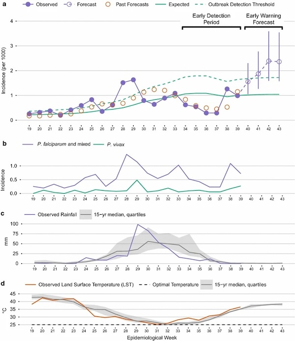

Malaria remains a major public health challenge in many low- and middle-income countries, particularly in sub-Saharan Africa. Strengthening malaria surveillance requires moving beyond reactive responses toward predictive approaches that provide advance warning of outbreaks and support more proactive disease control. Our research has advanced methods for malaria forecasting and outbreak detection by integrating routine disease surveillance with satellite Earth observations and predictive models. Working in the epidemic-prone Amhara region of Ethiopia, we developed and evaluated forecasting approaches that account for geographic variation in the delayed effects of climate on malaria transmission ([Midekisa et al. 2012](#malaria-refs), [Davis et al. 2019](#malaria-refs), [Nekorchuk et al. 2021](#malaria-refs)). We also evaluated alternative sources of environmental data ([Alemu and Wimberly 2020](#malaria-refs)) and developed informatics tools to make satellite observations more accessible for disease surveillance and forecasting ([Liu et al. 2015](#malaria-refs), [Wimberly et al. 2022](#malaria-refs)).

  *Time series visualizations for weekly forecasts from the EPIDEMIA system (Merkord et al. 2017).*

A major outcome of this research has been the development of the Epidemic Prognosis Incorporating Disease and Environmental Monitoring for Integrated Assessment (EPIDEMIA) system, an open-source platform that translates advances in environmental monitoring and predictive modeling into practical tools for malaria early warning ([Merkord et al. 2017](#malaria-refs)). Co-developed with Ethiopian public health partners, [EPIDEMIA](http://ecograph.net/epidemia/) integrates epidemiological and environmental data to detect emerging outbreaks and generate malaria forecasts up to 12 weeks in advance. Following a pilot implementation in the Amhara region, we worked with national stakeholders to develop a roadmap for scaling malaria early warning across Ethiopia ([Wimberly and Nekorchuk 2021](#malaria-refs)). We are now developing [EPIDEMIA 2.0](http://ecograph.net/epidemia/), a next-generation platform with improved visualization, modeling capabilities, and interoperability with existing public health information systems. These efforts aim to make malaria forecasting more accessible and actionable, helping public health agencies anticipate outbreaks and better target surveillance and control activities. 

### References {#malaria-refs}

- Wimberly, M. C., D. M. Nekorchuk, and R. R. Kankanala. 2022. [Cloud-based applications for accessing satellite Earth observations to support malaria early warning](https://www.nature.com/articles/s41597-022-01337-y). Scientific Data 9: 208.
- McMahon, A., A. Mihretie, A. A. Ahmed, M. Lake, W. Awoke, and M. C. Wimberly. 2021. [Remote sensing of environmental risk factors for malaria in different geographic contexts](https://ij-healthgeographics.biomedcentral.com/articles/10.1186/s12942-021-00282-0). International Journal of Health Geographics 20: 28.
- Nekorchuk, D. M., T. Gebrehiwot, M. Lake, W. Awoke, A. Mihretie, and M. C. Wimberly. 2021. [Comparing malaria early detection methods in a declining transmission setting in northwestern Ethiopia](https://bmcpublichealth.biomedcentral.com/articles/10.1186/s12889-021-10850-5). BMC Public Health 21: 788.
- Wimberly, M. C., and D. M. Nekorchuk. 2021. [Malaria Early Warning in Ethiopia: A Roadmap for Scaling to the National Level](https://www.climatelinks.org/resources/malaria-early-warning-ethiopia-roadmap-scaling-national-level). U.S. Agency for International Development.
- Alemu, W. G., and M. C. Wimberly. 2020. [Evaluation of remotely sensed and interpolated environmental datasets for vector-borne disease monitoring using *in situ* observations over the Amhara Region, Ethiopia](https://www.mdpi.com/1424-8220/20/5/1316/htm). Sensors 20: 1316.
- Davis, J. K., Gebrehiwot, T., Worku. M., Awoke, W., Mihretie, A., Nekorchuk, D., and M. C. Wimberly. 2019. [A genetic algorithm for identifying spatially-varying environmental drivers in a malaria time series model](https://www.sciencedirect.com/science/article/pii/S136481521930129X). Environmental Modelling and Software 119: 275-284.
- Merkord, C. L., Y. Liu, A. Mihretie, T. Gebrehiwot, W. Awoke, E. Bayabil, G. M. Henebry, G. T. Kassa, M. Lake, and M. C. Wimberly. 2017. [Integrating malaria surveillance with climate data for outbreak detection and forecasting: the EPIDEMIA system](https://malariajournal.biomedcentral.com/articles/10.1186/s12936-017-1735-x). Malaria Journal 16:89.
- Liu, Y., J. Hu, I. Snell-Feikema, M. S. VanBemmel, A. Lamsal, M. C. Wimberly. 2015. [Software to facilitate remote sensing data access for disease early warning systems](https://www.sciencedirect.com/science/article/pii/S1364815215300116). Environmental Modelling and Software 74: 238-246.
- Midekisa, A., G. Senay, G. M. Henebry, P. Semuniguse, and M. C. Wimberly. 2012. [Remote sensing-based time series models for malaria early warning in the highlands of Ethiopia](https://malariajournal.biomedcentral.com/articles/10.1186/1475-2875-11-165). Malaria Journal 11: 165.
