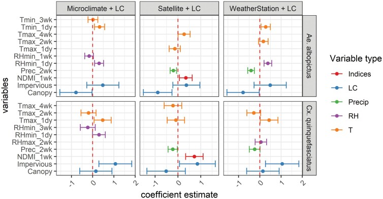

Mosquito abundance, behavior, and disease transmission potential are strongly influenced by environmental conditions. Aquatic habitats are essential for larval development, while temperature and atmospheric moisture regulate mosquito physiology, survival, and reproduction ([Brown et al. 2023](#mosquito-refs), [Huxley et al. 2026](#mosquito-refs)). These relationships vary among species and environmental settings, making it essential to understand how local weather, hydrology, and landscape characteristics interact to influence mosquito populations.

Our research has demonstrated substantial differences in the environmental drivers of mosquito abundance across species and geographic regions. In South Dakota, the floodwater mosquito *Aedes vexans* is strongly associated with wetland habitats and responds to heavy rainfall, whereas *Culex tarsalis*, an important West Nile virus vector, is associated with grasslands and responds more strongly to temperature ([Chuang et al. 2011](#mosquito-refs); [Chuang et al. 2012](#mosquito-refs)). In Oklahoma, *Culex quinquefasciatus* is most abundant in highly developed landscapes, while *Aedes albopictus* is associated with areas of low tree cover; both species are more abundant following periods of warm, humid weather with little rainfall ([McMahon et al. 2022](#mosquito-refs)). In Georgia, we demonstrated how land cover influences local microclimates, creating fine-scale variation in *Aedes albopictus* abundance and potential disease transmission ([Wimberly et al. 2020](#mosquito-refs)).

  *Effects of environmental variables from local microclimate, satellite remote sensing, and weather station data on Aedes albopictus and Culex quinquefasciatus abundance. Variables include spectral indices (Indices), land cover (LC), precipitation (Precip), relative humidity (RH), and temperature(T) (McMahon et al. 2022).*

An important contribution of this research has been identifying environmental indicators that are more closely linked to mosquito ecology than conventional weather measurements. Variables such as soil moisture, drought indices, and solar radiation can provide stronger predictors of mosquito abundance than temperature and precipitation alone ([Bump and Wimberly, 2026](#mosquito-refs)). Satellite Earth observations of surface water, vegetation, and land surface temperature can also perform as well as or better than ground-based meteorological measurements ([Chuang et al. 2012](#mosquito-refs); [McMahon et al. 2022](#mosquito-refs)). These findings highlight the importance of selecting ecologically relevant environmental predictors and measuring them at spatial and temporal scales appropriate for understanding mosquito populations and improving abundance forecasts.

### References {#mosquito-refs}

- Bump, R. R., and M. C. Wimberly. 2026. [Hydrometeorological drivers of mosquito (Diptera: Culicidae) abundance in an urbanized region of central Oklahoma](https://academic.oup.com/jme/article/63/4/tjag102/8732329). Journal of Medical Entomology 63: tjag102.
- Huxley, P. J., J. J. Brown, B. St. Laurent, B. Johnson, O. Y. Cheung, A. Asamoah, B. D. Hollingsworth, E. R. Bump, M. C. Wimberly, M. Pascual, L. R. Johnson, C. C. Murdock. 2026. [Beyond temperature: Relative humidity systematically shifts juvenile thermal performance and projected population growth in a malaria vector](https://doi.org/10.1111/ele.70416). Ecology Letters, 29:e70416.
- Brown, J. J., M. Pascual, M. C. Wimberly, L. R. Johnson, and C. C. Murdock. 2023. [Humidity – The overlooked variable in the thermal biology of mosquito-borne disease](https://onlinelibrary.wiley.com/doi/10.1111/ele.14228). Ecology Letters 26: 1029-1049.
- McMahon, A., C. M. B. Franca, and M. C. Wimberly. 2022. [Comparing satellite and ground-based measurements of environmental suitability for vector mosquitoes in an urban landscape](https://academic.oup.com/jme/article/59/6/1936/6747053). Journal of Medical Entomology 59: 1936-1946.
- Wimberly, M. C., J. K. Davis, M. V. Evans, A. Hess, P. M. Newberry, N. Solano-Asamoah, C. C. Murdock. 2020. [Land cover affects microclimate and temperature suitability for arbovirus transmission in an urban landscape](https://journals.plos.org/plosntds/article?id=10.1371/journal.pntd.0008614). PLoS Neglected Tropical Diseases 14(9): e0008614.
- Chuang, T., G. M Henebry, J. S. Kimball, D.L. VanRoekel-Patton, M. B. Hildreth, and M. C. Wimberly. 2012. [Satellite microwave remote sensing for environment modeling of mosquito population dynamics](https://www.sciencedirect.com/science/article/pii/S0034425712002921). Remote Sensing of Environment 125: 147-156.
- Chuang, T. M. B. Hildreth, M. B., D. L. VanRoekel, and M. C. Wimberly. 2011. [Weather and land cover influences on mosquito populations in Sioux Falls, South Dakota](http://www.bioone.org/doi/abs/10.1603/ME10246). Journal of Medical Entomology 48: 669-679.
