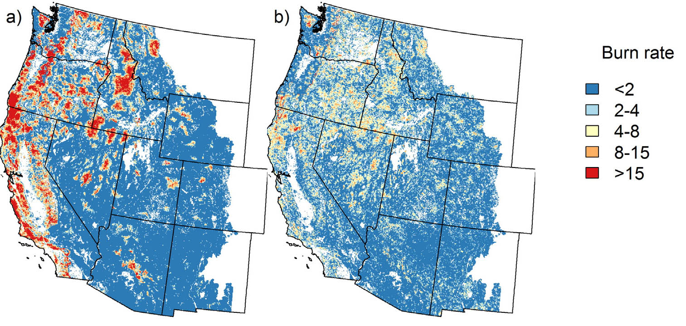
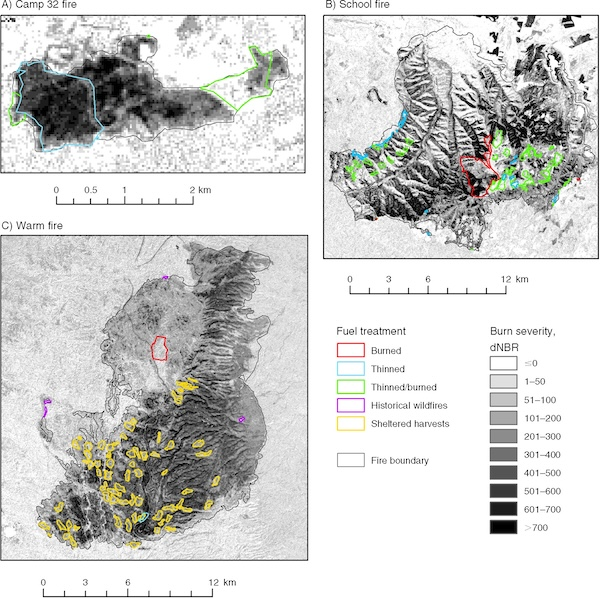

Wildfire regimes in western North America are changing in response to climate warming, vegetation shifts, and human alterations of forest landscapes. Our research has investigated the interacting effects of climate, vegetation, and land management on wildfire occurrence and behavior, using satellite remote sensing, spatial analysis, and landscape simulation models. These studies have contributed to understanding how wildfire regimes are changing, how forest management can mitigate fire risk, and how contemporary landscapes compare with historical conditions.

Our research demonstrated that climate change influences wildfire through both direct effects on fire weather and indirect effects on vegetation and fuels. Landscape simulations projected increases in burned area across the western United States, with climate-driven changes in vegetation potentially as important as changes in temperature and fuel moisture ([Liu and Wimberly 2015](#western-refs), [Liu and Wimberly 2016](#western-refs)). In the Colorado Front Range, we also found that climate change and expansion of the wildland–urban interface interact nonlinearly, with warming amplifying the fire risks associated with residential development in fire-prone landscapes ([Liu et al. 2015](#western-refs)). These findings highlight the importance of considering climate, vegetation dynamics, and human development together when assessing future wildfire risk.

  *Projected future fire regimes under climate change for a scenario allowing shifts in vegetation type (left) and a scenario maintaining current vegetation types (right) (Liu and Wimberly 2016).*

We also evaluated how forest management influences wildfire behavior and severity. Using satellite observations and fire behavior models, we demonstrated that fuel treatments combining canopy thinning with prescribed burning or mastication were more effective at reducing fire size and severity than treatments addressing canopy or surface fuels alone ([Wimberly et al. 2009](#western-refs), [Cochrane et al. 2012](#western-refs)). Research in eastern Washington revealed contrasting effects of forest roads: although ignitions were more frequent near roads, fire spread and severity were often reduced in their vicinity ([Narayanaraj and Wimberly, 2012](#western-refs), [Narayanaraj and Wimberly, 2011](#western-refs), [Narayanaraj and Wimberly, 2013](#western-refs)). These studies provide insights into how landscape configuration and management practices influence fire risk.

  *Maps burn severity derived from satellite remote sensing and fuel treatments for four wildfires in the western United States (Wimberly et al. 2009).*

An important contribution of our earlier research was reconstructing historical fire regimes and old-growth forest dynamics in the Pacific Northwest. We developed the Landscape Dynamics Simulator (LADS) to investigate how wildfire shaped forest age structure before widespread logging and fire suppression ([Wimberly et al. 2000](#western-refs), [Wimberly 2002](#western-refs)). Despite the occurrence of large wildfires, simulations indicated that old-growth forests historically occupied approximately 29–52% of forested landscapes, substantially more than their contemporary extent ([Wimberly et al. 2004](#western-refs)). Subsequent improvements to LADS incorporated mixed-severity fire regimes and explored how climate change could shift forest landscapes beyond their historical range of variability ([Wimberly and Kennedy 2008](#western-refs), [Kennedy and Wimberly 2009](#western-refs), [Wimberly and Liu 2014](#western-refs)). This work established a quantitative framework for understanding historical landscape variability and evaluating the long-term consequences of forest disturbance and management.

### References {#western-refs}

- Liu, Z., M. C. Wimberly. 2016. [Direct and indirect effects of climate change on projected future fire regimes in the western United States](https://www.sciencedirect.com/science/article/pii/S0048969715309098?via%3Dihub). Science of the Total Environment 542: 65-75.
- Liu, Z., M. C. Wimberly. 2015. [Climatic and landscape influences on fire regimes from 1984 to 2010 in the western United States](https://journals.plos.org/plosone/article?id=10.1371/journal.pone.0140839). PLoS One 10(10): e0140839.
- Liu, Z., M. C. Wimberly, A. Lamsal, T. L. Sohl, T. J. Hawbaker. 2015. [Climate change and wildfire risk in an expanding wildland-urban interface: a case study from the Colorado Front Range Corridor](https://link.springer.com/article/10.1007%2Fs10980-015-0222-4). Landscape Ecology 30: 1943-1957.
- Wimberly, M. C., and Z. Liu. 2014. [Interactions of climate, fire, and management in future forests of the Pacific Northwest](https://www.sciencedirect.com/science/article/pii/S0378112713006579). Forest Ecology and Management 327: 270-279.
- Narayanaraj, G., and M. C. Wimberly. 2013. [Influences of forest roads and their edge effects on the spatial pattern of burn severity](https://www.sciencedirect.com/science/article/pii/S0303243412002462). International Journal of Applied Earth Observation and Geoinformation 23: 62-70.
- Cochrane, M. A., C. J. Moran, M. C. Wimberly, A. D. Baer, M. A. Finney, K. L. Beckendorf, J. Eidenshink, and Z. Zhu. 2012. [Estimation of wildfire size and risk changes due to fuels treatment](http://www.publish.csiro.au/WF/WF11079). International Journal of Wildland Fire 21: 357-367.
- Narayanaraj, G., and M. C. Wimberly. 2012. [Influences of forest roads on the spatial patterns of human-and lightning-caused wildfire ignitions](https://www.sciencedirect.com/science/article/pii/S0143622811001731). Applied Geography 32: 878-888.
- Narayanaraj, G., and M. C. Wimberly. 2011. [Influences of forest roads on the spatial pattern of wildfire boundaries](https://www.publish.csiro.au/WF/WF10032). International Journal of Wildland Fire 20: 792-803.
- Wimberly, M. C., M. A. Cochrane, A. D. Baer, and K. Pabst. 2009. [Assessing fuel treatment effectiveness using satellite imagery and spatial statistics](https://esajournals.onlinelibrary.wiley.com/doi/10.1890/08-1685.1). Ecological Applications 19: 1377-1384.
- Kennedy, R. S. H., and M. C. Wimberly. 2009. [Historical fire and vegetation dynamics in dry forests of the interior Pacific Northwest, USA and relationships to Northern Spotted Owl (Strix occidentalis caurina) habitat conservation](https://www.sciencedirect.com/science/article/pii/S0378112709002977). Forest Ecology and Management 258: 554-566.
- Wimberly, M. C., and R. S. H. Kennedy. 2008. [Spatially explicit modeling of mixed-severity fire regimes and landscape dynamics in the interior Pacific Northwest](https://www.sciencedirect.com/science/article/pii/S0378112707005051). Forest Ecology and Management 254: 511-523.
- Wimberly, M. C., and J. L. Ohmann. 2004. [A multi-scale assessment of human and environmental constraints on forest land cover change on the Oregon (USA) Coast Range](https://link.springer.com/article/10.1023/B:LAND.0000042904.42355.f3). Landscape Ecology 19: 631-646.
- Wimberly, M. C., T. A. Spies, and E. Nonaka, 2004. [Using criteria based on the natural fire regimes to evaluate forest management in the Oregon Coast Range](https://www.researchgate.net/publication/308605616_Using_Criteria_Based_on_the_Natural_Fire_Regime_to_Evaluate_Forest_Management_in_the_Oregon_Coast_Range_of_the_United_States_Concepts_and_Applications). Page 146-157 In: Perera, A. H., L. J. Buse, and M. G. Weber, editors. Emulating Natural Forest Landscape Disturbances: Concepts and Applications. Columbia University Press, New York.
- Wimberly, M. C. 2002. [Spatial simulation of historical landscape patterns in coastal forests of the Pacific Northwest](http://www.nrcresearchpress.com/doi/abs/10.1139/x02-054#.XAQmBS2ZNBw). Canadian Journal of Forest Research 32: 1316-1328.
- Wimberly, M. C., T. A. Spies, C. J. Long, and C. Whitlock. 2000. [Simulating Historical Variability in the Amount of Old Forests in the Oregon Coast Range](https://onlinelibrary.wiley.com/doi/full/10.1046/j.1523-1739.2000.98284.x). Conservation Biology 14: 167-180.
