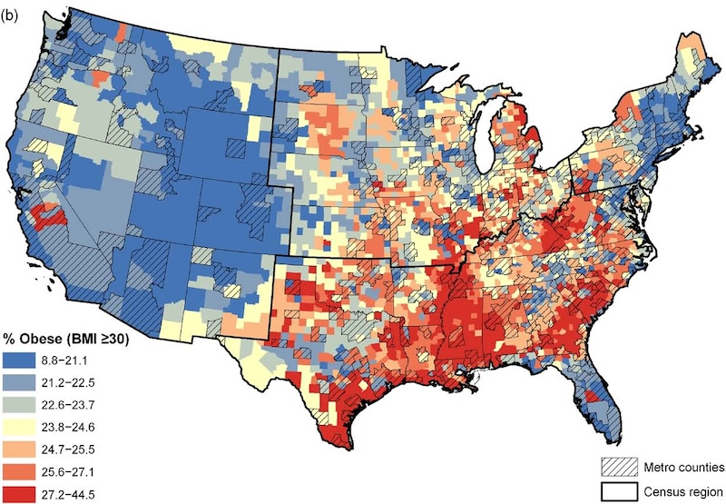

Geographic disparities in health reflect differences in the social, built, and natural environments where people live, as well as unequal access to health care and other essential resources. Our research has examined how these factors influence obesity, physical activity, and cancer care, with an emphasis on the distinctive challenges facing rural communities. Using county-level data from across the United States, we demonstrated that relationships between food environments and obesity differ between urban and rural settings. Obesity prevalence increased with distance to supermarkets in metropolitan counties, but no corresponding relationship was found in non-metropolitan counties ([Michimi and Wimberly 2010a](#social-refs), [Michimi and Wimberly 2010b](#social-refs)). Additional research examined associations between obesity and the availability of different types of food retailers in major U.S. cities ([Michimi and Wimberly 2015](#social-refs)). In rural counties, greater availability of parks, trails, and other recreational amenities was associated with higher physical activity and lower obesity prevalence ([Michimi and Wimberly 2012](#social-refs)). Together, these findings highlight the importance of considering geographic context when evaluating environmental influences on health and developing strategies to promote healthier communities.

  *Map of county-level obesity rates in the conterminous United States based on BRFSS data and smoothed using weighted head banging (Wimberly et al. 2010b).*

We also investigated how rural isolation and geographic access to health care contribute to disparities in cancer diagnosis and treatment. In South Dakota, residents of isolated and economically disadvantaged rural communities were more likely to receive a late-stage colorectal cancer diagnosis ([Lin and Wimberly 2017](#social-refs)). We also found that breast cancer patients with better geographic access to radiation therapy facilities were more likely to receive radiation therapy rather than mastectomy ([Lin et al. 2018](#social-refs)). These studies demonstrate how geographic barriers to specialized health services may influence both the timing of cancer diagnosis and the treatment options available to rural populations, underscoring the importance of addressing spatial inequalities in health care access.

### References {#social-refs}

- Lin, Y., M. C. Wimberly, P. Da Rosa, J. Hoover, and W. F. Athas. 2018. [Geographic access to radiation therapy facilities and disparities of early-stage breast cancer treatment](https://geospatialhealth.net/index.php/gh/article/view/622). Geospatial Health 13:622.
- Lin, Y., and M. C. Wimberly. 2017. [Geographic variations of colorectal and breast cancer late-stage diagnosis and the effects of neighborhood-level factors](https://onlinelibrary.wiley.com/doi/full/10.1111/jrh.12179). Journal of Rural Health 33: 146-157.
- Michimi, A., and M. C. Wimberly. 2015. [Food environment and adult obesity in US metropolitan areas](https://www.geospatialhealth.net/index.php/gh/article/view/368). Geospatial Health 10: 368.
- Michimi, A., and M. C. Wimberly. 2012. [Natural environments, obesity, and physical activity in nonmetropolitan areas of the United States](https://onlinelibrary.wiley.com/doi/full/10.1111/j.1748-0361.2012.00413.x). Journal of Rural Health 28: 398-407.
- Michimi, A., and M. C. Wimberly. 2010a. [Associations of supermarket accessibility with obesity and fruit and vegetable consumption in the conterminous United States](https://ij-healthgeographics.biomedcentral.com/articles/10.1186/1476-072X-9-49). International Journal of Health Geographics 9:49.
- Michimi, A., and M. C. Wimberly. 2010b. [Spatial patterns of obesity and associated risk factors in the conterminous U.S.](https://www.ajpmonline.org/article/S0749-3797(10)00320-X/abstract) American Journal of Preventive Medicine 39: e1-12.
