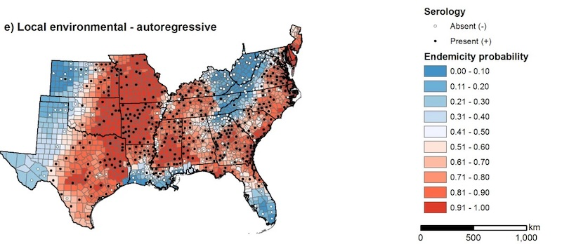

Ticks transmit a variety of disease-causing pathogens that are maintained in complex ecological cycles involving wildlife hosts and environmental conditions. The geographic distributions of ticks and their pathogens are influenced by climate, vegetation, and landscape characteristics, but these relationships vary across species and environmental settings. Our research has demonstrated that the environmental drivers of tick-borne pathogen distributions vary geographically, with climate playing a dominant role in the eastern United States and forest cover and fragmentation becoming more important near western range boundaries ([Yabsley et al. 2005](#tick-refs), [Wimberly et al. 2008b](#tick-refs)). We also documented the effects of forest cover and flooding on pathogen distributions in the Mississippi Alluvial Valley ([Manangan et al. 2007](#tick-refs)). Using Bayesian hierarchical models, we developed spatial predictions of tick-borne pathogen distributions that accounted for geographic variation in environmental relationships and spatial autocorrelation ([Wimberly et al. 2008a](#tick-refs)). These studies demonstrated the importance of incorporating spatially heterogeneous environmental relationships into models of tick-borne disease risk.

  *Map of the regional distribution of Ehrlichia chaffeensis based on a hierarchical Bayesian modeling incorporating spatially heterogeneous environmental predictors and spatial autocorrelation (Wimberly et al. 2008b).*

More recently, we collaborated with Anni Yang (University of Oklahoma) to investigate how urban landscapes and microenvironments influence tick abundance. In a study of 13 parks in the Oklahoma City metropolitan area, we found that the abundance of lone star ticks (*Amblyomma americanum*) was influenced by both local habitat characteristics and broader landscape conditions ([Marquez et al. 2025](#tick-refs)). Important predictors included woody vegetation, solar radiation, humidity, and soil characteristics at the local level and forest cover at the landscale scale. These findings highlight the highlight the potential for using environmental variables to predict potential areas of human exposure in urban green spaces.

### References {#tick-refs}

- Marquez, M. R., Talukder, H., Cheng, W., Becker, D. J., Wimberly, M. C., Yang, A. 2025. [Micro-and Macroenvironment and Habitat Influences on Tick Abundance in Oklahoma City Urban Parks](https://doi.org/10.4269/ajtmh.24-0418). American Journal of Tropical Medicine and Hygiene, 113, 187-199.
- Wimberly, M. C., A. B. Baer, and M. J. Yabsley. 2008a. [Enhanced spatial models for predicting the geographic distributions of tick-borne pathogens](https://ij-healthgeographics.biomedcentral.com/articles/10.1186/1476-072X-7-15). International Journal of Health Geographics 7:15.
- Wimberly, M. C., M. J. Yabsley, A. B. Baer, V. G. Dugan, and W. R. Davidson. 2008b. [Spatial heterogeneity of climate and land cover constraints on distributions of tick-borne pathogens](https://onlinelibrary.wiley.com/doi/abs/10.1111/j.1466-8238.2007.00353.x). Global Ecology and Biogeography 17: 189-202.
- Manangan, J. S., S. H. Schweitzer, N. Nibbelink, M. J. Yabsley, S. E. J. Gibbs, and M. C. Wimberly. 2007. [Habitat factors influencing distributions of Anaplasma phagocytophilum and Ehrlichia chaffeensis in the Mississippi Alluvial Valley](https://www.liebertpub.com/doi/abs/10.1089/vbz.2007.0116). Vector-Borne and Zoonotic Diseases 7: 563-574.
- Yabsley, M. J., M. C. Wimberly, D. E. Stallknecht, S. E. Little, and W. R. Davidson. 2005. [Spatial analysis of the distribution of Ehrlichia chaffeensis, causative agent of human monocytotropic ehrlichiosis, across a multi-state region](http://www.ajtmh.org/content/journals/10.4269/ajtmh.2005.72.840?related-urls=yes&legid=tropmed;72/6/840). American Journal of Tropical Medicine and Hygiene 72: 840-850.
