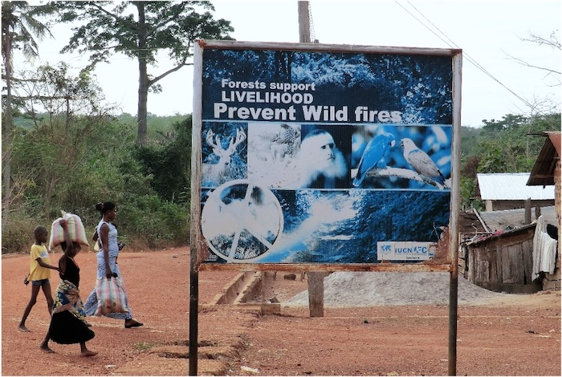
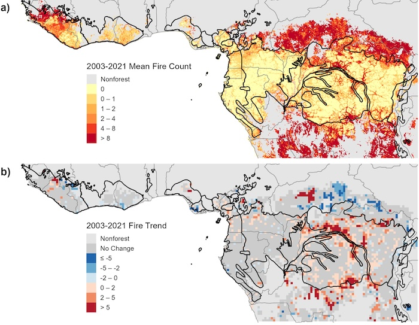

Tropical forests in West Africa are increasingly threatened by agricultural expansion, logging, and wildfires, with climate change amplifying their vulnerability to disturbance. These forests experience some of the highest temperatures and longest dry seasons among tropical forest ecosystems, making them particularly susceptible to drought and fire. Our research has documented changing fire regimes and forest degradation across tropical Africa, developed satellite-based approaches for monitoring and predicting forest disturbances, and assessed the long-term consequences of degradation for forest recovery and carbon storage.

  *Fire prevention sign located near Pamu-Berekum forest reserve in the Brong-Ahafo region of Ghana.*

We fount that fire activity is increasing in tropical African forests, even as it has declined in surrounding savanna ecosystems. In West Africa, vegetation characteristics largely determine the spatial distribution of fires, while climate influences their seasonality and intensity ([Dwomoh and Wimberly 2017b](#tropfor-refs)). Across the moist African tropics, increasing fire activity has been associated with rising temperatures, atmospheric moisture deficits, and deforestation ([Wimberly et al. 2024](#tropfor-refs)). Studies in Ghana's forest reserves have also revealed important feedbacks between fire and forest degradation: disturbances reduce canopy cover and promote the establishment of more flammable vegetation, increasing susceptibility to subsequent fires and potentially driving persistent forest loss ([Dwomoh and Wimberly 2017a](#tropfor-refs), [Dwomoh et al. 2019](#tropfor-refs)). These findings suggest that climate change and human disturbances may reinforce one another, increasing the risk of transitions from closed-canopy forest to more open, fire-prone vegetation.

  *Spatial patterns and time series trends of active fire detections from 2003-2021 across the African moist tropics (Wimberly et al. 2024).*

We have also advanced satellite-based methods for tracking forest degradation and identifying areas vulnerable to future disturbance. Across the Upper Guinean region of West Africa, we documented widespread declines in woody vegetation and increases in herbaceous cover ([Liu et al. 2017](#tropfor-refs)). Using Landsat time series, we reconstructed forest disturbance histories across Ghana's forest reserves, revealing a sharp increase in degradation and forest loss associated with drought and fires in 2016 ([Wimberly et al. 2022](#tropfor-refs)). Subsequent modeling demonstrated that landscape fragmentation, human population pressure, and drought can be used to identify areas at elevated risk of future disturbance ([Wanyama et al. 2023](#tropfor-refs)). We also found that biomass recovery following degradation is slow, highlighting the potential for disturbances to produce persistent reductions in forest carbon storage ([Wanyama et al. 2025](#tropfor-refs)). Together, these studies provide a foundation for anticipating forest degradation and identifying landscapes where conservation and restoration efforts may be most needed.

### References {#tropfor-refs}

- Wanyama, D., M. C. Wimberly, R. Doughty, and F. Mensah. 2025. [Forest aboveground biomass accumulation lags forest canopy recovery in degraded tropical forests of Ghana](https://doi.org/10.1016/j.jag.2025.104753). International Journal of Applied Earth Observation and Geoinformation, 142: 104753.
- Wimberly, M. C., D. Wanyama, R. Doughty, H. Peiro, and S. Crowell. 2024. [Increasing fire activity in African tropical forests is associated with deforestation and climate change](https://doi.org/10.1029/2023GL106240). Geophysical Research Letters, 51(9), e2023GL106240.
- Wanyama, D., M. C. Wimberly, and F. Mensah. 2023. [Patterns and drivers of disturbance in tropical forest reserves of southern Ghana](https://iopscience.iop.org/article/10.1088/1748-9326/acd399). Environmental Research Letters 18: 064022.
- Wimberly, M. C., F. K. Dwomoh, I. Numata, F. Mensah, J. Amoako, D. M. Nekorchuk, and A. McMahon. 2022. [Historical trends of degradation, loss, and recovery in the tropical forest reserves of Ghana](https://www.tandfonline.com/doi/full/10.1080/17538947.2021.2012533). International Journal of Digital Earth: 15(1), 30-51.
- Dwomoh, F. K., M. C. Wimberly, M. A. Cochrane, and I. Numata. 2019. [Forest degradation promotes fire during drought in moist tropical forests of Ghana](https://www.sciencedirect.com/science/article/pii/S0378112718321893). Forest Ecology and Management 440: 148-168.
- Dwomoh, F. K., and M. C. Wimberly. 2017a. [Fire regimes and forest resilience: alternative vegetation states in the West African tropics](https://link.springer.com/article/10.1007/s10980-017-0553-4). Landscape Ecology 32: 1849-1865.
- Dwomoh, F. K., and M. C. Wimberly. 2017b. [Fire regimes and their drivers in the Upper Guinean Region of West Africa](https://www.mdpi.com/2072-4292/9/11/1117/htm). Remote Sensing 9: 1117.
- Liu, Z., M. C. Wimberly, F. K Dwomoh. 2017. [Vegetation dynamics in the Upper Guinean Forest region of West Africa from 2001 to 2015](https://www.mdpi.com/2072-4292/9/1/5). Remote Sensing. 9(1): 5.
