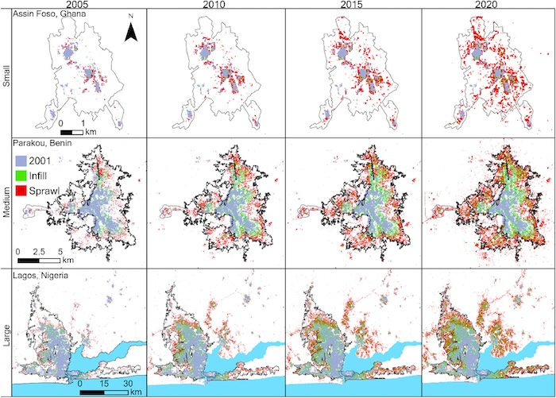

Urbanization is transforming landscapes across the Global South, particularly in Africa, where rapidly growing populations are driving widespread expansion of developed land. Although research has traditionally focused on large metropolitan areas, smaller secondary cities are increasingly important centers of urban growth. Our research uses satellite Earth observations to map urban expansion, investigate its underlying drivers, and assess its environmental consequences. We are also developing spatially explicit urban growth models to project future patterns of expansion and evaluate how urbanization and climate change may interact to influence human exposure to heat and infectious diseases ([Korah et al. 2024](#expansion-refs)).

  *Patterns of infill and sprawl urban expansion for three cities in West Africa (Korah et al. 2024a).*

Our research has demonstrated that secondary cities play an increasingly important role in urban expansion and environmental change across West Africa. We developed satellite-based mapping approaches that improve the detection of urban growth in smaller cities compared with existing global land cover products ([Korah and Wimberly, 2024b](#expansion-refs)). Analysis of two decades of urban expansion revealed that secondary cities are growing faster and exhibiting more sprawling development patterns than larger primary cities, accounting for an increasing share of developed land ([Korah and Wimberly, 2024a](#expansion-refs)). Complementary research in Ghana identified lower land and housing costs and more flexible land allocation as important factors contributing to the growth of secondary cities ([Korah et al. 2025](#expansion-refs)). We also demonstrated that urban expansion is a major driver of tree cover loss in Ghana and Nigeria, highlighting the environmental consequences of rapid urban growth ([Korah and Wimberly 2026](#expansion-refs)). Together, these findings underscore the importance of including secondary cities in urban planning, environmental monitoring, and projections of future land cover change.

### References {#expansion-refs}

- Korah, A. and M. C. Wimberly. 2026. [Expansion of cities drives tree cover loss in rapidly urbanizing regions of West Africa](https://doi.org/10.1016/j.ufug.2026.129434). Urban Forestry & Urban Greening, 120: 129434.
- Korah, A., Smith, L., Wimberly, M. C. 2025. [Understanding urban expansion across primary and secondary cities in Ghana](https://doi.org/10.1016/j.habitatint.2025.103339). Habitat International, 158, 103339.
- Korah, A., & M. C. Wimberly. 2024a. [Smaller cities have large impacts on West Africa's expanding urban system](https://doi.org/10.1016/j.scs.2024.105381). Sustainable Cities and Society, 106, 105381.
- Korah, A., & M. C. Wimberly. 2024b. [Annual impervious surface data from 2001-2020 for West African countries: Ghana, Togo, Benin, and Nigeria](https://doi.org/10.1038/s41597-024-03610-8). Scientific Data, 11, 791.
- Korah, A., J. A. M. Koch, and M. C. Wimberly. 2024. [Understanding urban growth modeling in Africa: Dynamics, drivers, and challenges](https://doi.org/10.1016/j.cities.2023.104734). Cities 146: 104734.
