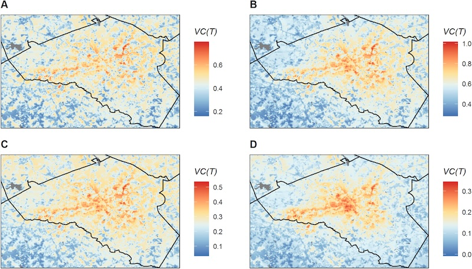

Urban areas are among the fastest-growing landscapes on the planet, and the transmission of diseases by urban-adapted mosquitoes has increased markedly over recent decades. Our research investigates how urban landscapes influence mosquito habitats, local microclimates, and disease transmission, with an emphasis on understanding the combined effects of environmental and socioeconomic conditions. We integrate satellite Earth observations, ground-based measurements, and disease transmission models to map urban transmission hotspots and anticipate how disease risk may change with urbanization and climate change. In the southeastern United States, we combined satellite observations and in situ microclimate measurements to generate high-resolution temperature maps, which were linked with mechanistic models to characterize neighborhood-level variation in potential dengue transmission ([Wimberly et al. 2020](#mosquito-refs)).

  *Maps of temperature-dependent vectorial capacity (VC(T)) for Athens-Clarke County, GA during four monthly periods in 2018 (Wimberly et al. 2020).*

Building on this work, we are collaborating with Courtney Murdock (Cornell University) and Mercedes Pascual (University of Chicago) to investigate urban malaria transmission by *Anopheles stephensi* in Ahmedabad and Surat, India. This research extends temperature-dependent transmission models to account for the effects of humidity on mosquito water balance and survival. We established a network of indoor and outdoor microclimate sensors in residential neighborhoods to characterize fine-scale temperature and humidity patterns and their relationships with urban land cover ([Jamal et al. 2025](#mosquito-refs)). Complementary household surveys examine how socioeconomic conditions and domestic water management practices influence malaria risk ([Batheja et al. 2026](#mosquito-refs)). We are integrating these environmental and socioeconomic data into spatial models to identify urban malaria hotspots and assess how transmission risk varies across neighborhoods. Related research with collaborators in Ethiopia has examined malaria trends in urbanizing environments and the implications of Anopheles stephensi invasion for urban malaria control ([Teka et al. 2023](#mosquito-refs)).

### References {#mosquito-refs}

- Batheja, D., D. Samria, M. C. Wimberly, M. Pascual, R. K. Baharia, A. K. Mohanty, V. Desai, K. Vaishnav, R. Sharma, V. Kohli, S. A. Sharma, A. Anvikar, C. C. Murdock, and A. Nandi. 2026. [Socioeconomic and household water management determinants of malaria and other vector-borne disease prevention in Urban Gujarat, India](https://doi.org/10.1186/s12936-026-05830-2). Malaria Journal, 25: 141.
- Jamal, Y., C. C. Murdock, R. K. Baharia, R. Sharma, K. Vaishnav, V. Desai, V. Kohli, A. K. Mohanty, M. Pascual, S. Sharma, A. Anvikar, and M. C. Wimberly. 2025. [Spatiotemporal patterns of urban heat in indoor and outdoor microclimates](https://doi.org/10.1088/1748-9326/ae09bc). Environmental Research Letters, 20: 114050.
- Teka, H. L. Golassa, G. Medhin, M. Balkew, C. Sisay, E. Gadisa, D. M. Nekorchuk, M. C. Wimberly, and F. G. Tadesse. 2023. [Trend analysis of malaria in urban settings in Ethiopia from 2014 to 2019](https://link.springer.com/article/10.1186/s12936-023-04656-6). Malaria Journal 22: 235.
- Wimberly, M. C., J. K. Davis, M. V. Evans, A. Hess, P. M. Newberry, N. Solano-Asamoah, C. C. Murdock. 2020. [Land cover affects microclimate and temperature suitability for arbovirus transmission in an urban landscape](https://journals.plos.org/plosntds/article?id=10.1371/journal.pntd.0008614). PLoS Neglected Tropical Diseases 14(9): e0008614.
