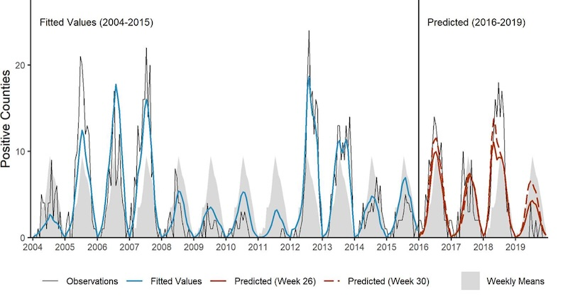

West Nile virus (WNV) is the most common mosquito-borne disease in the United States, with more than 53,000 reported cases and 2,500 deaths since its introduction in 1999. The northern Great Plains have consistently experienced some of the highest WNV incidence rates in the country, with cases concentrated in particular geographic areas and outbreak years ([Wimberly et al. 2013](#wnv-refs)). Because WNV transmission is highly seasonal, weather conditions during spring and early summer influence virus amplification in mosquitoes and birds and the subsequent risk of human infection ([Wimberly et al. 2014](#wnv-refs)). Building on these findings, we developed regional forecasting models that initially used satellite observations of vegetation greenup and temperature-based degree days to predict WNV incidence ([Chuang and Wimberly, 2012](#wnv-refs)). Subsequent research demonstrated that integrating environmental indicators with mosquito infection surveillance improves forecasting accuracy, providing a stronger foundation for anticipating WNV outbreaks ([Davis et al. 2017, 2018](#wnv-refs)).

  *ArboMAP forecasts of WNV in South Dakota, including historical calibration as well as predictions outside the range of the training data (Wimberly et al. 2022).*

We translated these advances into the Arbovirus Monitoring and Prediction (ArboMAP) system, a set of tools for implementing WNV forecasting in public health agencies. [ArboMAP](http://ecograph.net/arbomap/) has supported WNV forecasting in South Dakota since 2016, and was extended to Louisiana, Michigan, and Oklahoma ([Nekorchuk et al. 2023](#wnv-refs)). Retrospective validation demonstrated that models driven by environmental observations and mosquito surveillance data enabled accurate forecasts early enough to inform disease prevention and mosquito control before the peak transmission season ([Wimberly et al. 2022](#wnv-refs)). This work demonstrates the potential of integrating Earth observations and public health surveillance to move from reactive disease monitoring toward proactive outbreak preparedness. We are now developing [ArboMAP 2.0](http://ecograph.net/arbomap2/), a next-generation forecasting platform that incorporates additional environmental data streams, improved modeling capabilities, and enhanced visualization tools to support broader implementation across multiple states.

### References {#wnv-refs}

- Nekorchuk, D. M., A. Bharadwaja, S. Simonson, E. Ortega, C. M. B. Franca, E. Dinh, R. Reik, R. Burkholder, and M. C. Wimberly. 2024. [The Arbovirus Mapping and Prediction (ArboMAP) system for West Nile virus forecasting](https://doi.org/10.1093/jamiaopen/ooad110). JAMIA Open, 7: ooad110.
- Wimberly, M. C., J. K. Davis, M. B. Hildreth, and J. Clayton. 2022. [Integrated forecasts based on public health surveillance and meteorological information predict West Nile virus in a high-risk region of North America](https://ehp.niehs.nih.gov/doi/10.1289/EHP10287). Environmental Health Perspectives 130(8): 087006.
- Davis, J. K., G. P. Vincent, M. B. Hildreth, L. Kightlinger, C. Carlson, and M. C. Wimberly. 2018. [Improving the prediction of arbovirus outbreaks: a comparison of climate-driven models for West Nile virus in an endemic region of the United States](https://www.sciencedirect.com/science/article/pii/S0001706X18300512). Acta Tropica 185: 242-250.
- Davis, J. K., G. P. Vincent, M. B. Hildreth, L. Kightlinger, C. Carlson, and M. C. Wimberly. 2017. [Integrating environmental monitoring and mosquito surveillance to predict vector-borne disease: Prospective forecasts of a West Nile virus outbreak](http://currents.plos.org/outbreaks/index.html%3Fp=73093.html). PLoS Currents Outbreaks. 2017 May 23. Edition 1. doi: 10.1371/currents.outbreaks.90e80717c4e67e1a830f17feeaaf85de.
- Wimberly, M. C., A. Lamsal, P. Giacomo, and T. Chuang. 2014. [Regional variation of climatic influences on West Nile virus outbreaks in the United States](http://www.ajtmh.org/content/journals/10.4269/ajtmh.14-0239). American Journal of Tropical Medicine and Hygiene 91: 677-684.
- Wimberly, M. C., P. Giacomo, L. Kightlinger, and M. B. Hildreth. 2013. [Spatio-temporal epidemiology of human West Nile virus disease in South Dakota](https://www.mdpi.com/1660-4601/10/11/5584). International Journal of Environmental Research and Public Health 10: 5584-5602.
- Chuang T., and M. C. Wimberly. 2012. [Remote Sensing of Climatic Anomalies and West Nile Virus Incidence in the Northern Great Plains of the United States](https://journals.plos.org/plosone/article?id=10.1371/journal.pone.0046882). PLoS One 7:e46882.
