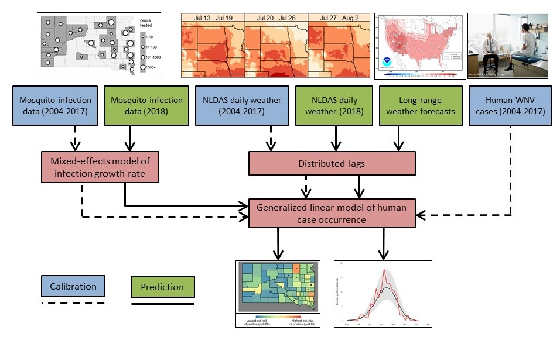
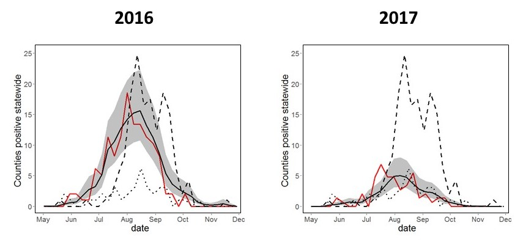

## Project Description

West Nile virus (WNV) is endemic in the United States and poses a persistent threat to public health. In particular, the Northern Great Plains are a hot spot for WNV transmission, and South Dakota has the highest long-term incidence of West Nile neuroinvasive disease in the country. We have conducted research on WNV epidemiology to explore the environmental risk factors that affect transmission to humans. The spatial and temporal distributions of vector mosquitoes and bird hosts, and the risk of disease in humans, are strongly influenced by temperature, humidity, vegetation, soils, and land use. These relationships can be quantified using mathematical models and applied to develop maps of WNV risk and forecast the probability of future outbreaks.

  *Conceptual diagram of information flow through the ArboMAP system.*

We have applied these results to develop a WNV early warning system for South Dakota that combines environmental monitoring with mosquito surveillance to produce weekly maps of WNV risk during the transmission season. The Arbovirus Mapping and Prediction (ArboMAP) system ingests gridded meteorological data using Google Earth Engine, a cloud-based platform for Earth science data analysis. Mosquito abundance and testing data are uploaded from locations throughout the state via a web-based surveillance platform. Statistical models are used to estimate the mosquito infection rate from recent surveillance data, and to predict the number of human cases based on mosquito infection rate, temperature, and humidity. These models are implemented using the R programming language and software environment, and all code is publicly available via GitHub. This work is supported in part by a grant from the NASA Applied Sciences Public Health and Air Quality Program (NNX15AF74G).

  *Prospective WNV forecasts. Black line/Gray shading: prediction with 95% intervals; Red line: Observed cases in 2016 or 2017; Dashed line: Observed cases in 2012; Dotted line: Observed cases in 2015.*

## Software and Data

[ArboMAP Software Archive](https://github.com/EcoGRAPH/ArboMAP)

## Partner Organizations

- Louisiana Department of Health
- OKC County Health Department
- Oklahoma State Department of Health
- Michigan Department of Health and Human Services
- South Dakota Department of Health
- South Dakota State University

## Funding Sources

- NASA (NNX15AF74G, NSSC19K1233)

## Publications

- Bump, E. R., and M. C. Wimberiy. 2026. [Hydrometeorological drivers of mosquito (Diptera: Culicidae) abundance in an urbanized region of central Oklahoma](https://doi.org/10.1093/jme/tjag102). Journal of Medical Entomology, 4: tjag102.
- Nekorchuk, D. M., A. Bharadwaja, S. Simonson, E. Ortega, C. M. B. Franca, E. Dinh, R. Reik, R. Burkholder, and M. C. Wimberly. 2024. [The Arbovirus Mapping and Prediction (ArboMAP) system for West Nile virus forecasting](https://doi.org/10.1093/jamiaopen/ooad110). JAMIA Open, 7: ooad110.
- Wimberly, M. C., J. K. Davis, M. B. Hildreth, and J. Clayton. 2022. [Integrated forecasts based on public health surveillance and meteorological information predict West Nile virus in a high-risk region of North America](https://ehp.niehs.nih.gov/doi/10.1289/EHP10287). Environmental Health Perspectives 130(8): 087006.
- Vincent, G. P., J. K. Davis, M. J. Wittry, M. C. Wimberly, Chris D. Carlson, D. L. Patton, and M. B. Hildreth. 2020. [Epidemic West Nile Virus Infection Rates and Endemic Population Dynamics Among South Dakota Mosquitoes: A 15-yr Study from the United States Northern Great Plains](https://academic.oup.com/jme/advance-article-abstract/doi/10.1093/jme/tjz231/5651347?redirectedFrom=fulltext). Journal of Medical Entomology 57: 862–871.
- Davis, J. K., G. P. Vincent, M. B. Hildreth, L. Kightlinger, C. Carlson, and M. C. Wimberly. 2018. [Improving the prediction of arbovirus outbreaks: a comparison of climate-driven models for West Nile virus in an endemic region of the United States](https://www.sciencedirect.com/science/article/pii/S0001706X18300512). Acta Tropica 185: 242-250.
- Hess, A., J. K. Davis, and M. C. Wimberly. 2018. [Identifying environmental risk factors and mapping the distribution of West Nile virus in an endemic region of North America](https://doi.org/10.1029/2018GH000161). GeoHealth 2: 395-409.
- Davis, J. K., G. P. Vincent, M. B. Hildreth, L. Kightlinger, C. Carlson, and M. C. Wimberly. 2017. [Integrating environmental monitoring and mosquito surveillance to predict vector-borne disease: Prospective forecasts of a West Nile virus outbreak](http://currents.plos.org/outbreaks/index.html%3Fp=73093.html). PLoS Currents Outbreaks. 2017 May 23. Edition 1. doi: 10.1371/currents.outbreaks.90e80717c4e67e1a830f17feeaaf85de.
- Wimberly, M. C., A. Lamsal, P. Giacomo, and T. Chuang. 2014. [Regional variation of climatic influences on West Nile virus outbreaks in the United States](http://www.ajtmh.org/content/journals/10.4269/ajtmh.14-0239). American Journal of Tropical Medicine and Hygiene 91: 677-684.
- Chuang T., and M. C. Wimberly. 2012. [Remote Sensing of Climatic Anomalies and West Nile Virus Incidence in the Northern Great Plains of the United States](https://journals.plos.org/plosone/article?id=10.1371/journal.pone.0046882). PLoS One 7:e46882.
